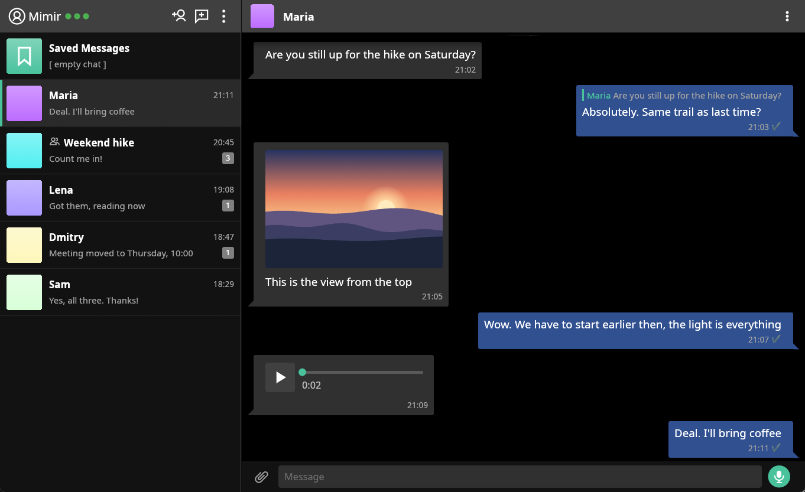
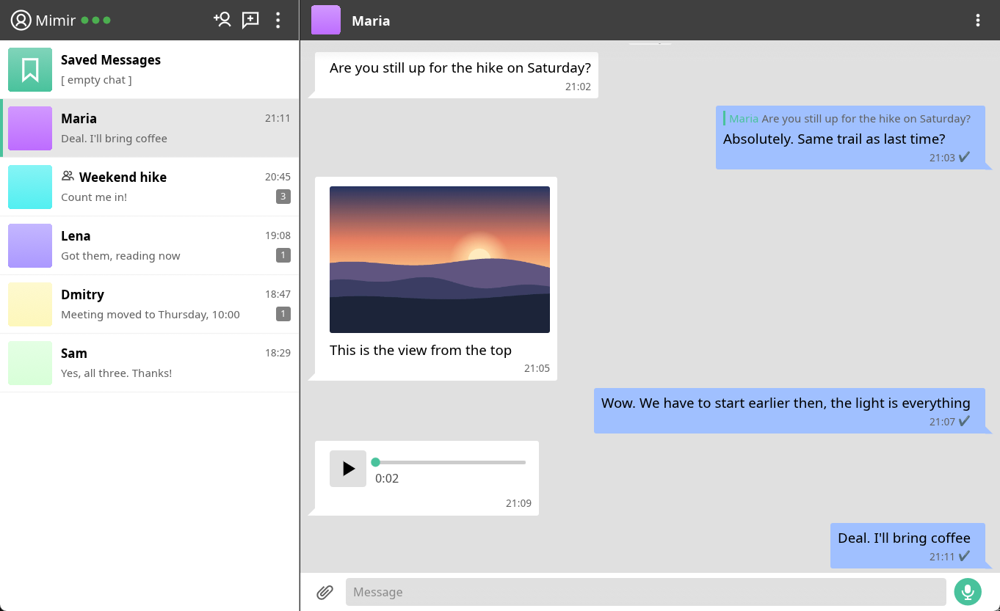
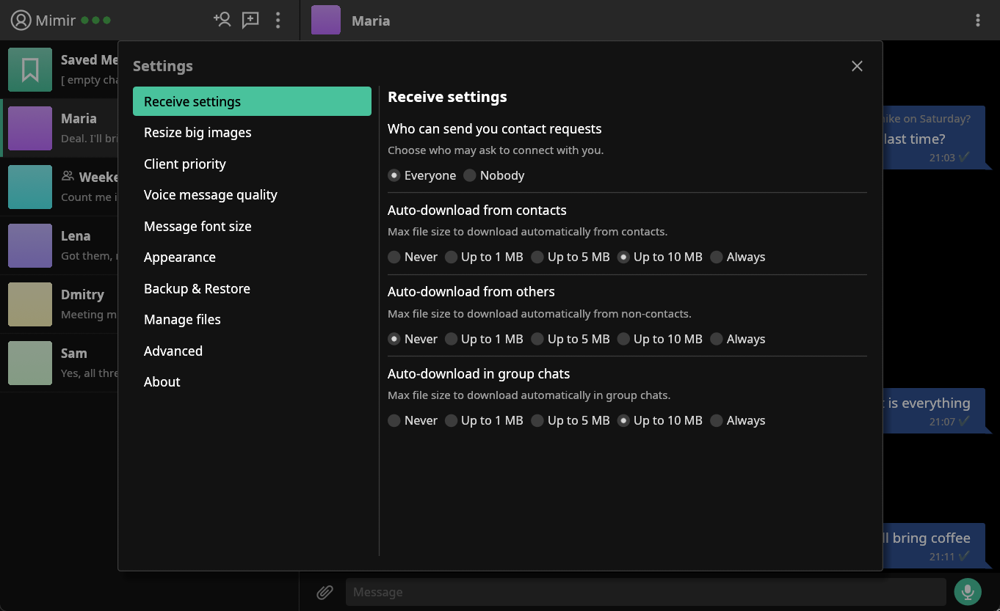

<p align="center">
  
</p>

<h1 align="center">Mimir Desktop</h1>

<p align="center">
  Desktop client for the <a href="https://github.com/Mimir-IM/MimirForAndroid">Mimir</a> messenger.<br>
  Peer-to-peer over the Yggdrasil network. No accounts, no phone numbers.
</p>

<p align="center">
  <a href="https://github.com/JB-SelfCompany/mimir-desktop/actions/workflows/ci.yml"></a>
  <a href="https://github.com/JB-SelfCompany/mimir-desktop/releases"></a>
  <a href="LICENSE"></a>
</p>

<p align="center">
  <a href="#download">Download</a> ·
  <a href="#features">Features</a> ·
  <a href="#building-from-source">Build</a> ·
  <a href="https://github.com/Mimir-IM/MimirForAndroid">Mimir for Android</a>
</p>

<p align="center">
  
</p>

Mimir Desktop runs the same core library as Mimir for Android and talks to it on equal terms: the same account, contacts, groups, attachments and voice messages. Import a backup from your phone and the computer becomes a second device of your account; both stay in sync.

The window follows the Android app closely, so nothing has to be relearned. It is written in Rust with [egui](https://github.com/emilk/egui) and runs on Windows and Linux.

## Features

**Messaging.** One-to-one chats and Saved Messages, replies, reactions, forwarding, drafts, delivery ticks, unread markers.

**Groups and channels.** Private and public groups and channels through mediator servers, invitations and join links, member roles and bans, several mediators side by side.

**Calls.** Voice calls one to one and in groups.

**Media.** Photos with a built-in viewer, files of any type, voice messages in the same AAC format Android records, video messages recorded from a webcam. Drag and drop or paste an image with Ctrl+V.

**Backup.** Import an Android backup to bring your history over, export one to move back. Settings travel with it.

**Desktop.** Lives in the tray, notifies about new messages, group invites and incoming calls, opens `mimir://` links from the browser, runs one copy per profile and updates itself.

**Settings.** The same options as on Android: auto-download limits, who may send contact requests, image resizing, voice quality, font size, Yggdrasil peers, mediators. Light and dark theme, English and Russian.

<table>
  <tr>
    <td></td>
    <td></td>
  </tr>
</table>

## Download

Get the latest build from the [releases page](https://github.com/JB-SelfCompany/mimir-desktop/releases):

| File | For |
| --- | --- |
| `…-windows-x86_64-setup.exe` | Windows. Installs for the current user without admin rights and adds a Start menu entry and an uninstaller. |
| `…-windows-x86_64.zip` | Windows, portable. Unpack and run. |
| `mimir-desktop_…_amd64.deb` | Debian and Ubuntu: `sudo apt install ./mimir-desktop_*_amd64.deb` |
| `…-linux-x86_64.tar.gz` | Other Linux distributions. Unpack and run. |

`SHA256SUMS` holds the checksums of all of them.

Voice messages, video messages and calls use [`ffmpeg`](https://ffmpeg.org/download.html). The Windows builds include it, and the .deb installs it as a dependency. With the tar.gz, install it from your distribution or put it next to the executable. Everything else works without it.

The tar.gz needs GTK 3 and ALSA, which most desktops already have, and `libayatana-appindicator3-1` for the tray icon.

### Updates

Once a day Mimir looks for a new release and shows a banner above the chat list; the check can be turned off or run by hand in Settings. On Windows and with the tar.gz, Update downloads the new version, checks it against `SHA256SUMS` and restarts. The .deb is not replaced in place: the banner opens the release page, and you install the new package the same way as the first one.

## Building from source

The core library is a path dependency, so clone it next to this repository:

```sh
git clone https://github.com/JB-SelfCompany/mimir-desktop
git clone https://github.com/Mimir-IM/mimir upstream/mimir
git clone https://github.com/Revertron/ygg_stream upstream/ygg_stream
cd mimir-desktop
cargo build --release
```

The core revisions CI builds against are pinned in [`ci.yml`](.github/workflows/ci.yml). On Debian and Ubuntu install the system libraries first:

```sh
sudo apt install libgtk-3-dev libasound2-dev libxkbcommon-dev libxdo-dev libayatana-appindicator3-dev pkg-config
```

Run the tests with `cargo test`. Set `MIMIR_DATA_DIR` to keep a second profile apart from your main one.

## Related projects

- [Mimir for Android](https://github.com/Mimir-IM/MimirForAndroid), the mobile client
- [mimir](https://github.com/Mimir-IM/mimir), the core library
- [mimir-mediator](https://github.com/Mimir-IM/mimir-mediator), the group chat server
- [Yggdrasil](https://yggdrasil-network.github.io/), the network underneath

## License

[Mozilla Public License 2.0](LICENSE). The bundled Noto fonts are under the [SIL Open Font License](assets/fonts/OFL.txt); the sounds come from Mimir for Android, under the [MIT License](assets/sounds/LICENSE.txt).
